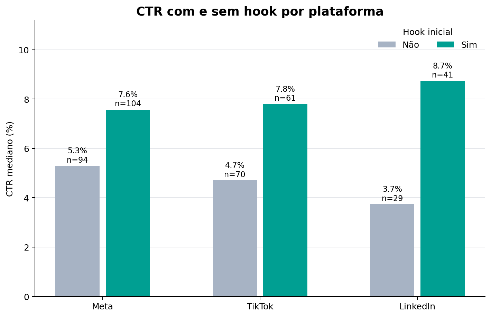
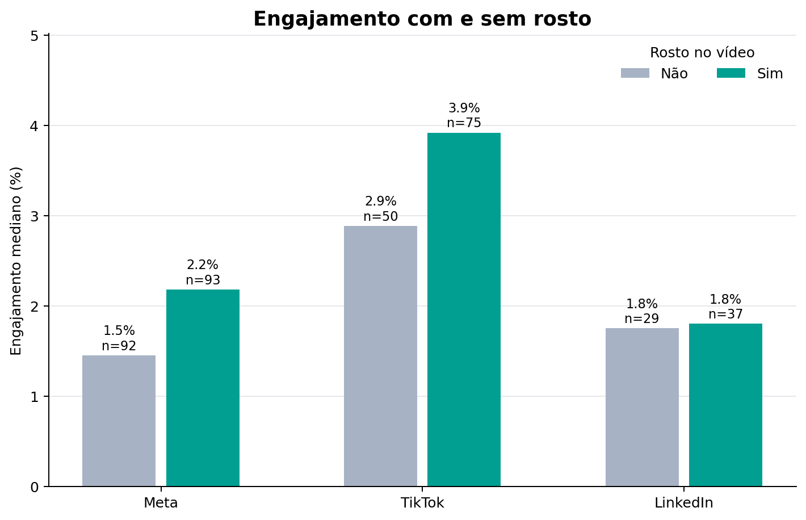
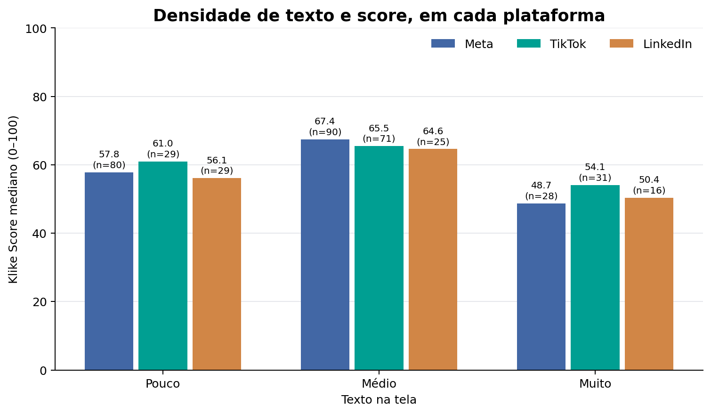

# Klike Score antes da campanha ir ao ar

Uma campanha que ainda não foi publicada não tem cliques, CTR ou ROAS. Por isso, este projeto parte de uma pergunta: **dá para estimar o `klike_score` usando apenas as informações do criativo e da campanha?** E, a partir dessa estimativa, quais mudanças poderiam valer um teste?

A base tem 500 campanhas simuladas. No período separado para teste, o modelo teve um erro médio de **7,17 pontos** em uma escala de 0 a 100. Também foi criado um sistema simples de recomendações. Para a campanha `KLK-0169`, ele encontrou quatro alterações possíveis.

Essas sugestões mostram caminhos para testar. Os dados disponíveis não permitem afirmar que uma alteração vai causar exatamente o aumento previsto.

## Como rodar

Use Python 3.12. Dentro da pasta do projeto, rode:

```bash
python -m venv .venv
source .venv/bin/activate
pip install -r requirements.txt

python analise.py
python modelo.py
python recomenda.py --id KLK-0169
```

No PowerShell, o comando para ativar o ambiente é `.venv\Scripts\Activate.ps1`.

`analise.py` cria os gráficos e o arquivo `resultados/eda.json`. `modelo.py` compara os modelos, salva os resultados em `resultados/modelo.json` e cria `artefatos/modelo.joblib`. O arquivo `recomenda.py` usa esse modelo para mostrar sugestões para uma campanha. Para analisar outra, basta trocar o ID no último comando.

A base original está em `dados/klike_challenge_dataset.csv`.

## 1. Entendendo os dados

As campanhas foram separadas por data. As **399 campanhas até 22/10/2024** foram usadas na análise e no treino. As **101 campanhas a partir de 24/10/2024** ficaram para o teste final. Assim, o modelo é avaliado em campanhas posteriores às que usou para aprender. Os gráficos desta seção mostram somente o grupo de treino.

Nesse grupo, o score mediano é **61,0** e varia de **13,4 a 99,1**. Há 198 campanhas Meta, 131 TikTok e 70 LinkedIn. Sete colunas têm valores ausentes. A coluna `revenue` tem **4,3%** de dados faltantes, enquanto `has_subtitle` tem **9,0%**.

Antes de comparar os resultados, também foi necessário conferir a qualidade da base. Alguns gastos e números de impressões são muito altos em relação aos demais, mas isso pode acontecer em campanhas maiores. Por isso, esses valores foram mantidos.

Já algumas métricas não batem com as contas que deveriam representá-las: **3 registros** têm CTR diferente de `clicks / impressions`, **5** têm CPC diferente de `spend / clicks` e **2** têm ROAS diferente de `revenue / spend`. Alguns registros aparecem em mais de um grupo. Os IDs podem ser consultados em `resultados/eda.json`.

As três linhas com CTR inconsistente não entraram nas comparações de CTR usadas nas recomendações nem no cálculo de conversões por mil impressões. Outro detalhe da base é que **46 campanhas têm CTR exatamente igual a 15%**. Isso pode indicar um limite usado na simulação.

### O que apareceu na análise



O primeiro padrão foi a diferença entre campanhas com e sem hook no começo do vídeo. O CTR mediano com hook foi **7,58% contra 5,30%** no Meta, **7,80% contra 4,70%** no TikTok e **8,74% contra 3,74%** no LinkedIn. Os grupos têm, respectivamente, `n=104/94`, `n=61/70` e `n=41/29` campanhas com e sem hook.

As conversões por mil impressões válidas também foram maiores nos grupos com hook: **1,98 contra 1,40** no Meta, **1,77 contra 1,13** no TikTok e **2,39 contra 1,20** no LinkedIn.

Isso não se repetiu da mesma forma no ROAS. No Meta, a mediana foi **1,26× com hook e 1,66× sem**. No TikTok, foi **3,09× com hook e 2,20× sem**. Como as campanhas podem ter objetivos e públicos diferentes, esses números mostram uma relação na base, mas não provam que o hook produziu sozinho a diferença.



A presença de um rosto no vídeo também parece depender do contexto. No Meta, o engajamento mediano foi **2,18% com rosto e 1,45% sem**. No TikTok, foi **3,92% e 2,89%**. Já no LinkedIn, os números ficaram próximos: **1,80% e 1,75%**.



Outra diferença apareceu na quantidade de texto na tela. Campanhas com densidade média tiveram score mediano maior que as de densidade alta nas três plataformas: **67,45 contra 48,70** no Meta, **65,50 contra 54,10** no TikTok e **64,60 contra 50,40** no LinkedIn. O gráfico mostra quantas campanhas há em cada grupo.

Também foram gerados gráficos da [distribuição do score por plataforma](figuras/01_score_por_plataforma.png) e do [ROAS por plataforma e objetivo](figuras/05_roas_por_objetivo.png). O ROAS mediano geral foi **2,66× no TikTok, 1,51× no Meta e 0,45× no LinkedIn**. Como os tipos e os objetivos das campanhas mudam entre plataformas, essa diferença não é suficiente para dizer que uma plataforma causa um retorno maior.

A duração do vídeo, por sua vez, teve correlação de Spearman muito próxima de zero com CTR (**−0,009**) e score (**−0,026**). Com esta base, não há um motivo claro para recomendar uma duração específica para todas as campanhas.

## 2. Prevendo o score

O modelo recebe informações que já existem antes da publicação: plataforma, categoria, objetivo, idade do público, retargeting, duração, formato, legendas, CTA, hook, presença de rosto, densidade de texto e proporção entre música e voz.

Cliques, CTR, gasto, receita, ROAS e engajamento ficaram fora. Essas informações só aparecem depois que a campanha roda e, portanto, não ajudariam a resolver a pergunta inicial do projeto. A data foi usada para separar os períodos, e `campaign_id` serve apenas para localizar cada campanha.

Antes do treino, os dados faltantes são preenchidos e as categorias são transformadas em números que os modelos conseguem usar. Essas etapas ficam dentro de um `Pipeline`, para que cada rodada de validação aprenda o preparo usando apenas os dados disponíveis naquele momento. A duração do vídeo também passa por uma transformação `log1p`, que reduz o peso de valores muito altos.

Foram comparadas três opções: prever sempre a mediana histórica, usar uma regressão Ridge ou usar uma Random Forest. A comparação foi feita nos mesmos cinco blocos de validação temporal. O critério para escolher o modelo foi o menor erro absoluto médio, chamado **MAE**.

| Modelo | MAE na validação | RMSE na validação | R² na validação |
| --- | ---: | ---: | ---: |
| Mediana histórica | 12,04 ± 0,90 | 14,93 ± 1,00 | −0,013 ± 0,016 |
| Ridge | **7,20 ± 0,99** | **9,05 ± 1,04** | **0,625 ± 0,066** |
| Random Forest | 8,20 ± 1,58 | 10,21 ± 1,55 | 0,526 ± 0,090 |

O Ridge teve o menor MAE na validação. Depois de ser treinado novamente com as 399 campanhas, foi avaliado nas 101 campanhas reservadas para teste. O resultado foi **MAE de 7,17**, **RMSE de 9,05** e **R² de 0,737**.

O MAE de 7,17 significa que a diferença entre o score real e o previsto foi de cerca de sete pontos **em média**. Algumas campanhas tiveram erros maiores. No teste, o MAE foi **6,42** no TikTok (`n=45`), **7,30** no Meta (`n=43`) e **9,35** no LinkedIn (`n=13`). O grupo de LinkedIn é pequeno, então essa diferença ainda precisaria ser investigada com mais dados.

Por último, foi medido o quanto a previsão piorava ao embaralhar cada atributo. Os maiores aumentos no MAE vieram de `has_hook` (**+5,61**), `has_face` (**+3,14**), `text_density` (**+2,32**), `has_subtitle` (**+1,31**) e `has_cta` (**+1,02**). Isso mostra quais atributos são mais úteis **para a previsão do modelo**. Não significa que adicionar um hook a qualquer anúncio aumentaria seu score em 5,61 pontos.

## 3. Sugestões para testar

O sistema de recomendações considera cinco mudanças possíveis: colocar um hook, mostrar um rosto, incluir legendas, adicionar um CTA ou mudar a densidade do texto para média. Cada mudança é analisada separadamente. Se a campanha já tem aquela característica, ela não é sugerida de novo.

Para cada alteração, o sistema compara a previsão do score atual com a previsão para uma versão modificada. Ele também procura campanhas parecidas no grupo de treino para verificar como foi o CTR mediano em cada situação.

A busca começa por campanhas da mesma **plataforma, categoria e objetivo**. Quando não há pelo menos dez exemplos de cada lado, o grupo é ampliado aos poucos até chegar, no máximo, à mesma plataforma. A própria campanha é retirada da comparação quando faz parte do treino.

Uma sugestão só aparece quando o modelo prevê aumento de score **e** o grupo com a alternativa apresenta CTR mediano maior. As sugestões são organizadas pelo aumento previsto no score.

Para `KLK-0169`, uma campanha Meta de E-commerce com objetivo de tráfego e score observado de **39,4**, o resultado foi:

| Mudança sugerida | Diferença prevista no score | CTR mediano dos grupos comparados | Contexto (`n` atual/alternativa) |
| --- | ---: | ---: | --- |
| Hook nos primeiros três segundos | +16,0 pontos | 7,23% → 7,82% (+0,59 p.p.) | Meta / E-commerce / traffic (13/16) |
| Texto na tela: alto → médio | +13,4 pontos | 3,97% → 6,53% (+2,56 p.p.) | Meta (27/90) |
| Versão com rosto humano | +11,6 pontos | 7,13% → 8,35% (+1,22 p.p.) | Meta / E-commerce / traffic (17/12) |
| Legendas legíveis | +7,5 pontos | 6,80% → 8,14% (+1,34 p.p.) | Meta / E-commerce / traffic (11/15) |

No caso do texto, foi preciso usar todas as campanhas Meta porque os grupos mais específicos não tinham exemplos suficientes. Essa comparação, portanto, traz menos informação sobre uma campanha de E-commerce com objetivo de tráfego do que as outras três.

Os pontos de score são diferenças entre previsões do modelo. Já os CTRs vêm de **outras campanhas**. Nenhum desses valores é uma promessa para `KLK-0169`, e os aumentos previstos para mudanças separadas não devem ser somados. O próximo passo seria criar variantes e comparar seus resultados em um teste A/B.

O sistema pode mostrar menos de três sugestões para uma campanha que já tenha várias dessas características ou para a qual faltem comparações suficientes. Essa é uma limitação do protótipo.

## 4. Como isso poderia virar um produto

Com acesso aos vídeos originais, seria possível analisar características que não aparecem no CSV: em que segundo surge a primeira mensagem importante, quando a marca aparece, o que é falado, se as legendas estão sincronizadas, quanto texto aparece em cada cena e como são os cortes no início do vídeo. Uma parte dessas informações poderia ser extraída automaticamente, mas seria necessário conferir exemplos manualmente. Reconhecer um rosto ou uma legenda não é o mesmo que avaliar se a mensagem ficou boa.

No uso diário, o vídeo seria enviado para um processo que valida o arquivo e extrai essas características. Depois, um serviço receberia também plataforma, categoria e objetivo para devolver a estimativa de score e as sugestões. Cada resposta deveria mostrar de onde vieram as comparações, quantas campanhas foram usadas e qual versão do modelo gerou o resultado.

Com mais dados, seria importante acompanhar onde o modelo mais erra e se o perfil das campanhas muda com o tempo. Também seria necessário confirmar com a Klike como o `klike_score` é calculado e em que momento fica disponível. Para saber se uma sugestão realmente melhora o desempenho, o caminho seria testar variantes em condições comparáveis, com um experimento A/B.

## Referência de método

A estrutura do projeto segue temas do [handout de Machine Learning do Insper](https://insper.github.io/ML/pt/), principalmente [análise exploratória](https://insper.github.io/ML/pt/2026.2/classes/eda/), [pré-processamento](https://insper.github.io/ML/pt/2026.2/classes/preprocessing/), [pipelines](https://insper.github.io/ML/pt/2026.2/classes/pipelines/), [regressão](https://insper.github.io/ML/pt/2026.2/classes/linear-regression/), [validação](https://insper.github.io/ML/pt/2026.2/classes/validation/) e [explicabilidade](https://insper.github.io/ML/pt/2026.2/classes/explainability/). A parte de recomendações foi montada para o problema deste desafio.